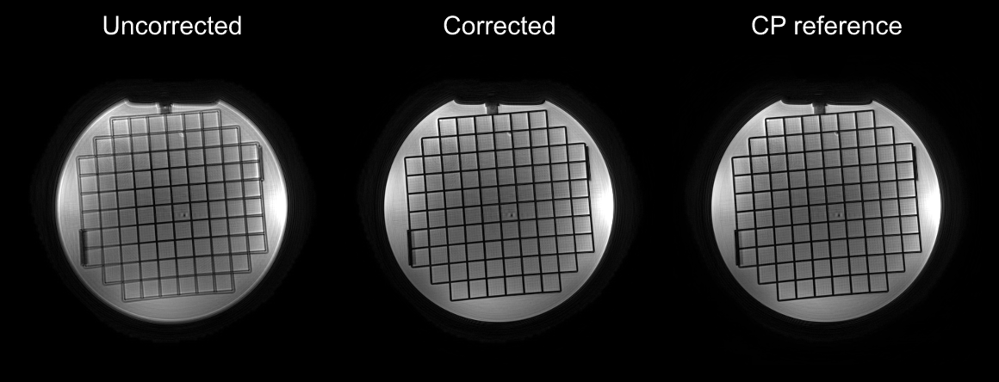
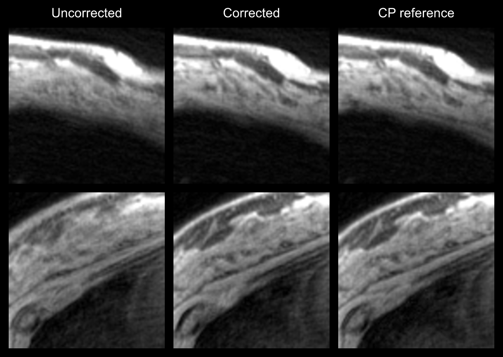

# Iterative shell correction

Off-resonance correction for center-out MRI without a separate field-map scan.

**Phantom**



**Breast patches**



Requires Python 3.10+, NumPy, SciPy and resvg_py.

```bash
python -m pip install -r requirements.txt
```

[Example downloads](https://github.com/onat-dalmaz/iterative-shell-correction/releases/tag/ismrm-example-data-v1)
include one phantom and one volunteer. Save both ZIPs in `example-data/`, then run:

```bash
python -m zipfile -e example-data/example-phantom-standard.zip example-data
python -m zipfile -e example-data/example-volunteer-S03.zip example-data
python experiments.py run phantom --inputs example-data/phantom.json --data example-data --case standard_autoshim --out outputs/phantom-example
python experiments.py run volunteers --inputs example-data/volunteers.json --data example-data --case S03 --out outputs/volunteer-example
python plot_figures.py --figures 4 --out outputs/figures
```

Outputs go to `outputs/`. Figure 4 plots saved results without scan data.
The full comparisons use three phantom scans and five volunteers; the remaining
scan arrays and plotting tiles are not included. See [INPUTS.txt](INPUTS.txt) for
formats, settings and full-cohort commands.

The phase-tracking step builds on Brian Hargreaves' [hierarchical shell
correction](https://github.com/mribri999/timesegmentedphase).
